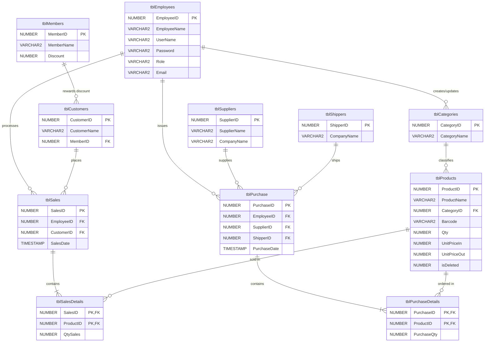

# Sales and Purchase Management System

Enterprise desktop Sales, Purchase, and Inventory Management System built with **C# (.NET 10)**, **Avalonia UI**, and **Oracle Database (PL/SQL)**. Designed and developed as the Year IV, Semester II Oracle Database Project at RPITSSR University.

---

## Table of Contents

- [Overview](#overview)
- [System Architecture](#system-architecture)
- [Key Features](#key-features)
- [Technology Stack](#technology-stack)
- [Database Schema and Design](#database-schema-and-design)
- [Stored Procedures Catalog](#stored-procedures-catalog)
- [Project Directory Structure](#project-directory-structure)
- [Prerequisites](#prerequisites)
- [Database Setup Guide](#database-setup-guide)
- [Application Configuration](#application-configuration)
- [Running the Application](#running-the-application)
- [Default User Accounts](#default-user-accounts)
- [Automated Testing and Verification](#automated-testing-and-verification)
- [Author and Academic Information](#author-and-academic-information)

---

## Overview

The **Sales and Purchase Management System** is an end-to-end relational database application engineered for retail and wholesale businesses. It automates inventory control, sales order processing, supplier procurement, member discount tracking, and employee management.

All database interactions operate through optimized **Oracle Database Stored Procedures** using input parameters and output `SYS_REFCURSOR` handles. This guarantees data integrity, parameter sanitization, and separation of concerns between business logic and database execution.

---

## System Architecture

The application adopts an enterprise 3-tier / N-tier architecture:

```
+-------------------------------------------------------------+
|                     Presentation Layer                      |
|       Avalonia UI 11.2 (Cross-Platform Desktop Windows)      |
|   MainForm | EmployeeForm | ProductForm | SalesForm | etc.  |
+------------------------------+------------------------------+
                               |
                               v
+-------------------------------------------------------------+
|                       Service Layer                         |
|   Validation, Business Logic, Session & Authorization       |
|    EmployeeService | ProductService | SalesService | etc.   |
+------------------------------+------------------------------+
                               |
                               v
+-------------------------------------------------------------+
|                      Repository Layer                       |
|        ODP.NET Core (Oracle.ManagedDataAccess.Core)         |
|   Executes Stored Procedures, Binds REF CURSORs, Mappings   |
+------------------------------+------------------------------+
                               |
                               v
+-------------------------------------------------------------+
|                    Oracle Database Engine                   |
|   Schema: SALESPURCHASEDB (Oracle 23ai / 21c / FREEPDB1)     |
|   11 Tables | Constraints | Stored Procedures | Sequences   |
+-------------------------------------------------------------+
```

---

## Key Features

- **Authentication and Session Security**:
  - Secure login with role-based privileges (`Admin`, `Manager`, `Staff`, `Cashier`).
  - Active session tracking for audit trails (`CreatedBy`, `UpdateBy`).
- **Product and Inventory Management**:
  - Barcode lookup, category assignment, buy/sell unit pricing, and stock monitoring.
  - Soft-delete (`isDeleted = 1`) and record restoration (`SP_PRODUCT_RESTORE`).
- **Sales and Billing (Master-Detail)**:
  - Cashier checkout supporting customer assignment, member discounts, and line-item details.
  - Automatic inventory deduction upon sale confirmation.
- **Purchase Orders and Procurement**:
  - Vendor procurement with supplier and shipper selection.
  - Master-detail purchase orders with automated stock increment.
- **Customer and Membership Loyalty**:
  - Customer directory linked to tiered membership discounts.
- **Supplier and Shipper Logistics**:
  - Directory of suppliers, manufacturers, and courier shipping companies.
- **Classic Desktop UI**:
  - Cross-platform desktop interface (macOS, Windows, Linux) built with Avalonia UI.
  - Top navigation toolbar, central workspace, and live status bar with user and clock info.

---

## Technology Stack

- **Framework**: .NET 10.0 (C#)
- **GUI Framework**: Avalonia UI 11.2 (Desktop, Fluent Theme, DataGrid)
- **Database Engine**: Oracle Database 23ai Free / Oracle Database 21c
- **Database Driver**: `Oracle.ManagedDataAccess.Core` (v23.26.301)
- **Configuration**: `Microsoft.Extensions.Configuration.Json`
- **Environment**: Docker container / Local Oracle installation

---

## Database Schema and Design

The database schema comprises **11 normalized tables** enforcing primary keys, foreign keys, uniqueness, and check constraints:



---

## Stored Procedures Catalog

All data operations are encapsulated inside PL/SQL stored procedures:

| Domain | Stored Procedures | Operation |
|---|---|---|
| **Authentication** | `SP_EMPLOYEE_LOGIN` | Authenticate user credentials and return profile |
| **Employees** | `SP_EMPLOYEE_INSERT`, `SP_EMPLOYEE_UPDATE`, `SP_EMPLOYEE_DELETE`, `SP_EMPLOYEE_SELECT_ALL`, `SP_EMPLOYEE_SELECT_BY_ID` | Full employee administration |
| **Members** | `SP_MEMBER_INSERT`, `SP_MEMBER_UPDATE`, `SP_MEMBER_DELETE`, `SP_MEMBER_SELECT_ALL`, `SP_MEMBER_SELECT_BY_ID` | Membership tiers and discounts |
| **Customers** | `SP_CUSTOMER_INSERT`, `SP_CUSTOMER_UPDATE`, `SP_CUSTOMER_DELETE`, `SP_CUSTOMER_SELECT_ALL`, `SP_CUSTOMER_SELECT_BY_ID` | Customer records and member linking |
| **Categories** | `SP_CATEGORY_INSERT`, `SP_CATEGORY_UPDATE`, `SP_CATEGORY_DELETE`, `SP_CATEGORY_SELECT_ALL`, `SP_CATEGORY_SELECT_BY_ID` | Product classifications |
| **Products** | `SP_PRODUCT_INSERT`, `SP_PRODUCT_UPDATE`, `SP_PRODUCT_DELETE`, `SP_PRODUCT_RESTORE`, `SP_PRODUCT_SELECT_ALL`, `SP_PRODUCT_SELECT_BY_ID` | Inventory, soft-deletion, and restore |
| **Suppliers** | `SP_SUPPLIER_INSERT`, `SP_SUPPLIER_UPDATE`, `SP_SUPPLIER_DELETE`, `SP_SUPPLIER_SELECT_ALL`, `SP_SUPPLIER_SELECT_BY_ID` | Vendor management |
| **Shippers** | `SP_SHIPPER_INSERT`, `SP_SHIPPER_UPDATE`, `SP_SHIPPER_DELETE`, `SP_SHIPPER_SELECT_ALL`, `SP_SHIPPER_SELECT_BY_ID` | Shipping and courier partners |
| **Sales** | `SP_SALE_INSERT`, `SP_SALE_DELETE`, `SP_SALE_SELECT_ALL`, `SP_SALE_SELECT_BY_ID` | Sales order header transactions |
| **Sales Details** | `SP_SALES_DETAIL_INSERT`, `SP_SALES_DETAIL_SELECT`, `SP_SALES_DETAIL_DELETE` | Line items with automatic stock reduction |
| **Purchases** | `SP_PURCHASE_INSERT`, `SP_PURCHASE_DELETE`, `SP_PURCHASE_SELECT_ALL`, `SP_PURCHASE_SELECT_BY_ID` | Purchase order header transactions |
| **Purchase Details**| `SP_PURCHASE_DETAIL_INSERT`, `SP_PURCHASE_DETAIL_SELECT`, `SP_PURCHASE_DETAIL_DELETE` | Line items with automatic stock replenishment |

---

## Project Directory Structure

```
SALESPURCHASEDB/
├── Data/                             # Root connection & config handlers
│   ├── DatabaseConfig.cs
│   └── OracleDbConnection.cs
├── Models/                           # Domain entities
│   ├── Category.cs
│   ├── Customer.cs
│   ├── Employee.cs
│   ├── Member.cs
│   ├── Product.cs
│   ├── Purchase.cs
│   ├── PurchaseDetail.cs
│   ├── Sale.cs
│   ├── SalesDetail.cs
│   ├── Shipper.cs
│   └── Supplier.cs
├── Repositories/                     # Root data access repositories
│   ├── CategoryRepository.cs
│   ├── EmployeeRepository.cs
│   └── ProductRepository.cs
├── Services/                         # Root business services
│   ├── CategoryService.cs
│   ├── EmployeeService.cs
│   └── ProductService.cs
├── SalesPurchaseManagement/          # Avalonia Desktop GUI Project
│   ├── Data/                         # Database connection helpers
│   ├── Models/                       # Presentation domain models
│   ├── Repositories/                 # Complete ODP.NET repositories
│   ├── Security/                     # Session state & logged-in user
│   ├── Services/                     # Business services
│   ├── Views/                        # Avalonia UI Views
│   │   ├── Dialogs/                  # Modal popups & alerts
│   │   ├── CategoryForm.cs
│   │   ├── CustomerForm.cs
│   │   ├── EmployeeForm.cs
│   │   ├── LoginForm.cs
│   │   ├── MainForm.cs
│   │   ├── MemberForm.cs
│   │   ├── ProductForm.cs
│   │   ├── PurchaseForm.cs
│   │   ├── SalesForm.cs
│   │   ├── ShipperForm.cs
│   │   └── SupplierForm.cs
│   ├── App.cs                        # Avalonia application entry & theme
│   ├── Program.cs                    # Avalonia bootstrap
│   ├── appsettings.json              # GUI database configuration
│   └── SalesPurchaseManagement.csproj
├── Scripts/                          # Database PL/SQL deployment scripts
│   ├── 01_create_tables.sql          # 11 Tables with DDL & constraints
│   ├── 02_create_stored_procedures.sql # All CRUD & transaction procedures
│   ├── 03_seed_data.sql              # Initial test data
│   ├── 04_step6_tests.sql            # Quick PL/SQL execution verification
│   └── 05_step7_full_test_suite.sql  # 640-line comprehensive test suite
├── Program.cs                        # CLI Integration verification runner
├── SALESPURCHASEDB.csproj            # CLI Project file
├── appsettings.json                  # Database connection string
├── .gitignore                        # Git exclusion rules
└── README.md                         # Documentation
```

---

## Prerequisites

1. **.NET 10 SDK**:
   - Check version: `dotnet --version`
2. **Oracle Database 23ai or 21c**:
   - Running natively or via Docker:
     ```bash
     docker run -d \
       --name sales-purchase-db \
       -p 1521:1521 \
       -e ORACLE_PASSWORD=SysPassword123 \
       container-registry.oracle.com/database/free:latest
     ```

---

## Database Setup Guide

Execute the SQL scripts in numerical order using SQL*Plus, SQL Developer, or DBeaver:

### 1. Connect to Pluggable Database (FREEPDB1)
```sql
ALTER SESSION SET CONTAINER = FREEPDB1;
```

### 2. Create the User / Schema
```sql
CREATE USER SALESPURCHASEDB IDENTIFIED BY Shop123;
GRANT CONNECT, RESOURCE, DBA TO SALESPURCHASEDB;
ALTER USER SALESPURCHASEDB QUOTA UNLIMITED ON USERS;
```

### 3. Deploy Schema and Objects
Connect as `SALESPURCHASEDB`:
```bash
sqlplus SALESPURCHASEDB/Shop123@localhost:1521/FREEPDB1 @Scripts/01_create_tables.sql
sqlplus SALESPURCHASEDB/Shop123@localhost:1521/FREEPDB1 @Scripts/02_create_stored_procedures.sql
sqlplus SALESPURCHASEDB/Shop123@localhost:1521/FREEPDB1 @Scripts/03_seed_data.sql
```

---

## Application Configuration

Configure the Oracle database connection in `appsettings.json` (and `SalesPurchaseManagement/appsettings.json`):

```json
{
  "ConnectionStrings": {
    "OracleDbConnection": "User Id=SALESPURCHASEDB;Password=Shop123;Data Source=localhost:1521/FREEPDB1;"
  }
}
```

---

## Running the Application

### 1. Run the Avalonia Desktop UI
```bash
dotnet run --project SalesPurchaseManagement/SalesPurchaseManagement.csproj
```

### 2. Run the Stored Procedure Integration Verification Test
```bash
dotnet run --project SALESPURCHASEDB.csproj
```

---

## Default User Accounts

Use the following seeded accounts to log in to the system:

| Username | Password | User Type | Role |
|---|---|---|---|
| `dara` | `123456` | Admin | Administrator |
| `sokha` | `123456` | Staff | Cashier |

---

## Automated Testing and Verification

The repository provides two levels of automated testing:

1. **PL/SQL Automated Suite (`Scripts/05_step7_full_test_suite.sql`)**:
   - Compiles and verifies all 50+ stored procedures without error (`user_errors`).
   - Executes end-to-end CRUD across every table.
   - Tests transaction rollbacks, identity generation, and stock recalculation.
2. **C# ODP.NET Integration Runner (`Program.cs`)**:
   - Executes live calls to `SP_EMPLOYEE_INSERT`, `SP_EMPLOYEE_SELECT_ALL`, `SP_EMPLOYEE_SELECT_BY_ID`, `SP_EMPLOYEE_UPDATE`, and `SP_EMPLOYEE_DELETE`.
   - Confirms parameter binding, REF CURSOR deserialization, and connection stability.

---

## Author and Academic Information

- **Institution**: Regional Polytechnic Institute Techo Sen Siem Reap (RPITSSR)
- **Academic Year**: Year IV, Semester II
- **Subject**: Oracle Database Programming & System Development
- **Repository**: [https://github.com/Tan-Saphea/Sales-Project-Year4.git](https://github.com/Tan-Saphea/Sales-Project-Year4.git)
